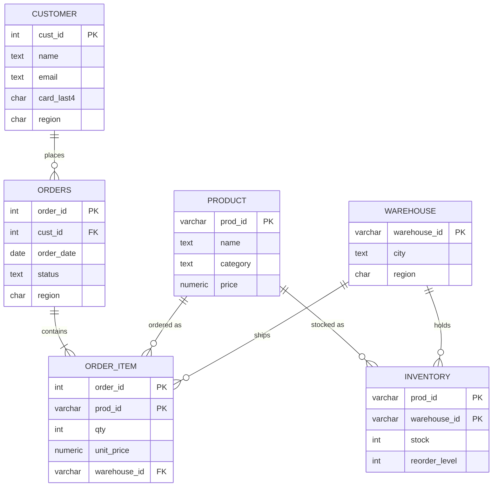

# Distributed Order Management System for an E-Commerce Company

**Course:** Distributed Database Management System  |  **Technology:** PostgreSQL 16 + Python 3

> Before submitting: run `./run_all.sh`, paste excerpts from `results/demo_output.txt` into
> Section 12, and add your name, roll number and date on the cover page.

---

## 1. Problem statement

An online retailer sells across India from three regional centres: **North** (Delhi/Amritsar),
**West** (Mumbai) and **South** (Bengaluru). Most activity is local: customers browse,
order and track within their own region. Head office still needs company-wide reports,
and some orders must be fulfilled from another region's warehouse when local stock runs out.

A single central database would make every order pay for a wide-area round trip and be a
single point of failure. A distributed database keeps data close to where it is used while
presenting one logical database to the user.

**Objectives**
1. Design the database top-down: global schema, fragmentation, allocation, data dictionary.
2. Give users location transparency (global queries are rewritten automatically).
3. Keep orders and stock consistent across sites (2PC, strict 2PL, deadlock handling).
4. Recover correctly from crashes.
5. Automate business rules with triggers and protect data with role-based access control.

---

## 2. Database life cycle (DBLC) as followed

| DBLC phase | What was done in this project |
|---|---|
| 1. Requirements analysis | Interviews replaced by scenario analysis: regional customers, cross-region fulfilment, no overselling, head-office reporting, privacy of e-mail/card data. |
| 2. Conceptual design | ER model (Section 4): six entities, relationships and cardinalities. |
| 3. DBMS selection | Relational model and PostgreSQL: ACID transactions, `PREPARE TRANSACTION` for 2PC, triggers, roles, views, row-level locking. |
| 4. Logical design | Mapping of ER to relations, normalisation to 3NF (Section 5). |
| 5. Distribution design (DDB-specific) | Fragmentation, replication, allocation, data dictionary (Section 7). |
| 6. Physical design | Primary keys, FKs, CHECK constraints that enforce fragmentation predicates, per-site sequences for globally unique ids (`sql/site_schema.sql`). |
| 7. Implementation and loading | `setup.sh`, `seed.py`: three sites, catalog, roles, deterministic sample data. |
| 8. Testing and validation | Eight demo scenarios (`demo.py`) with recorded output. |
| 9. Operation and maintenance | Recovery manager, audit tables (`price_audit`, `stock_log`), `teardown.sh`/`setup.sh` for rebuilds. |

---

## 3. Database model choice

| Model | Why it was or was not chosen |
|---|---|
| Hierarchical / network | Rigid navigational access; many-to-many order-product relation is awkward. |
| Object-oriented | Rich types, but weaker tooling and no need for complex objects here. |
| **Relational (chosen)** | Declarative SQL, constraints, mature transaction support, natural fit for fragmentation algebra (selection, projection, semi-join). |

---

## 4. Conceptual design (ER diagram)



(Render with any Mermaid viewer, e.g. GitHub, VS Code "Markdown Preview Mermaid Support", or mermaid.live, and paste the image into the final report.)

---

## 5. Normalisation (to 3NF)

**Unnormalised order form**

`ORDER_FORM(order_id, order_date, status, cust_id, cust_name, cust_email, cust_region, { prod_id, prod_name, category, price, qty, warehouse_id, warehouse_city, stock })`

**Functional dependencies**

* order_id -> order_date, status, cust_id
* cust_id -> name, email, card_last4, region
* prod_id -> name, category, price
* warehouse_id -> city, region
* (order_id, prod_id) -> qty, unit_price, warehouse_id
* (prod_id, warehouse_id) -> stock, reorder_level

| Step | Problem | Action |
|---|---|---|
| 1NF | Repeating group of products inside one order | One row per (order, product) |
| 2NF | prod_name, category, price depend only on prod_id; customer attributes only on cust_id | Split into PRODUCT, CUSTOMER, ORDERS, ORDER_ITEM |
| 3NF | Transitive: order_id -> cust_id -> cust_name; warehouse_id -> city; stock depends on (prod, warehouse) not on the order | Move to CUSTOMER, WAREHOUSE, INVENTORY |

**Result:** CUSTOMER, PRODUCT, WAREHOUSE, ORDERS, ORDER_ITEM, INVENTORY, all in 3NF.

*Deliberate note:* `ORDER_ITEM.unit_price` copies the price at order time. It is not a normalisation
violation because it is a historical fact about the order line (it must not change when PRODUCT.price changes later).

---

## 6. Architecture and DDBMS class

* **Types of DDBMS:** a homogeneous, loosely coupled system (same DBMS at all sites, each site autonomous).
* **Level of data and process distribution:** **MPMD** (multiple processes, multiple data sites). The coordinator
  process, three DBMS server processes and the per-site connections cooperate on one global request,
  and the data live at multiple sites. Single-site-processing (SPSD) would be one central DB; MPSD would run several
  processes against one site.

```
            +-----------------------------------------------+
            |  Python coordinator (ddbms.py)                |
            |  catalog lookup | query rewriting | 2PC | WFG |
            +-----+-------------------+-------------------+-+
                  |                   |                   |
        +---------v------+  +---------v------+  +---------v------+     +----------------+
        | ddbms_north    |  | ddbms_west     |  | ddbms_south    |     | ddbms_catalog  |
        | fragments N    |  | fragments W    |  | fragments S    |     | data dictionary|
        +----------------+  +----------------+  +----------------+     +----------------+
```

---

## 7. Distributed database design (top-down)

### 7.1 Design issues
Fragmentation must be **complete** (no tuple lost), **reconstructable** (union / join gives the original) and
**disjoint** (except replicas). Allocation balances local access, replication cost and security.

### 7.2 Fragmentation

| Relation | Technique | Definition | Why |
|---|---|---|---|
| ORDERS | Primary horizontal | ORDERS_X = SIGMA region='X' (ORDERS) | Orders are created and read in the customer's region |
| ORDER_ITEM | **Derived** horizontal | ORDER_ITEM_X = ORDER_ITEM SEMIJOIN ORDERS_X | Keeps the ORDERS-ORDER_ITEM join local; no data shipping |
| INVENTORY | Derived horizontal | by WAREHOUSE.region | Stock lives where the warehouse is |
| CUSTOMER | **Hybrid** (horizontal by region, then vertical) | PUB = PI(cust_id,name,region); SEC = PI(cust_id,email,card_last4) | Sensitive attributes get stricter privileges (`secure` schema) |
| PRODUCT, WAREHOUSE | Replicated | full copy at each site | Small, read-mostly, needed in every local join |

Correctness: completeness (every order has exactly one region value, enforced by `CHECK`), reconstruction
(ORDERS = U ORDERS_X; CUSTOMER = CUSTOMER_PUB JOIN CUSTOMER_SEC on cust_id), disjointness (CHECK constraints reject foreign-region rows).

### 7.3 Allocation (from the data dictionary)

| Fragment | Site(s) | Access pattern | Reason |
|---|---|---|---|
| ORDERS_N / _W / _S | N / W / S | very high, local writes | Order entry local |
| ORDER_ITEM_N / _W / _S | N / W / S | very high | Co-located with ORDERS |
| INVENTORY_N / _W / _S | N / W / S | high local, medium remote | Stock at its warehouse |
| CUSTOMER_PUB_x | x | high | Local browsing/login |
| CUSTOMER_SEC_x | x | low | Rarely read; protected |
| PRODUCT, WAREHOUSE | all | very high read, rare update | Replication saves remote reads; updates use 2PC |

### 7.4 Data dictionary
Implemented as database `ddbms_catalog` (`sql/catalog.sql`) with tables `site`, `global_relation`, `fragment`, `allocation`.
The query processor reads it at run time: it never has hard-coded fragment names. Adding a fourth site means inserting rows, not rewriting code.

---

## 8. Query processing (Chapters 1.5 and 2.1)

Pipeline implemented in `run_global_query()`:

1. **Decomposition:** normalise the query, analyse its join graph, simplify.
2. **Localization:** replace each global relation by the union of its fragments (from the catalog).
3. **Reduction:** *fragment elimination* (`region='N'` contradicts `ORDERS_W`, `ORDERS_S`), *join reduction* (derived fragmentation makes `ORDERS_i JOIN ORDER_ITEM_j` empty for i != j, so n local joins replace n^2), *vertical reduction* (query needs only name/region so `CUSTOMER_SEC` is never touched).
4. **Optimisation:** push selections, local joins and partial aggregation to the sites; ship only small partial results. `AVG` is rewritten as `SUM/COUNT` because averaging averages is wrong.
5. **Execution:** one thread per site, in parallel. 6. **Merge** at the coordinator.

Five queries are demonstrated (Scenario 2): total sales per category, average order value, regional selection with fragment elimination, low-stock report, customers per region.

---

## 9. Transaction management (Chapter 2.2)

* **Two-phase commit.** `DistTxn.commit_2pc()`: phase 1 `PREPARE TRANSACTION` at every participant and a vote is logged; the decision is **forced to the coordinator log**, then phase 2 `COMMIT PREPARED` / `ROLLBACK PREPARED`. A cross-region order touches the home site (order rows) and a remote warehouse (stock) atomically.
* **Strict two-phase locking.** Stock rows are read with `SELECT ... FOR UPDATE`; locks persist until the 2PC commit completes. Scenario 4 compares a naive read-then-write (both buyers get the last unit: lost update) to the locked version (second buyer waits, sees 0, is rejected). Serializability follows from strict 2PL.
* **Deadlock.** Scenario 5 builds a cross-site cycle (T-a locks North then wants West; T-b the reverse). Each PostgreSQL site sees only one wait, so no local detector can find it. `DeadlockDetector` unions the sites' wait-for edges (`pg_blocking_pids`), finds the cycle by DFS, and cancels the youngest transaction, which retries.

---

## 10. Recovery (Chapter 2.3)

| Failure | Handling |
|---|---|
| Transaction failure (e.g. insufficient stock) | Rollback of all branches; coordinator logs END/ABORT |
| Site/coordinator crash before decision | Branches are *in doubt* (prepared, locks held). Recovery finds no COMMIT in the log, so **UNDO** (`ROLLBACK PREPARED`): presumed abort |
| Crash after decision logged | Recovery finds COMMIT in the log, so **REDO** (`COMMIT PREPARED`) |
| Orphan prepared branch not in log | Rolled back by the orphan scan |

PostgreSQL's own WAL guarantees that each site's local changes survive restart; the coordinator log guarantees atomicity across sites. `stock_log` records before and after images that make the undo/redo effect visible. Scenario 6 also shows the **blocking problem** of 2PC: while the coordinator is down, other transactions cannot touch the locked rows.

---

## 11. Active database, views and access control

**Triggers (`sql/site_schema.sql`)**

| Trigger | Event | Action |
|---|---|---|
| `trg_auto_restock` | stock updated below reorder level | insert OPEN restock request (no duplicates while one is open) |
| `trg_price_audit` | product price updated | log old/new price and user |
| `trg_stock_log` | stock updated | before/after image with the global transaction id |

**Access control for e-commerce (self-study topic)**

| Role | Can | Cannot |
|---|---|---|
| `ddbms_admin` | everything, including `secure.customer_secure` | |
| `regional_manager` (`mgr_north`, ...) | read own site's orders, inventory, restocks; masked customer e-mails; update order status | read e-mail/card data; connect to other sites |
| `customer_role` (`cust_1001`, ...) | product catalogue; own orders via `v_my_orders` | any other customer's data; raw tables |

Mechanisms: `REVOKE CONNECT ... FROM PUBLIC` with per-site grants, schema separation for the vertical fragment, views for masking and row filtering,
column-level `GRANT UPDATE (status)`, and the least-privilege principle. Scenario 8 also demonstrates `REVOKE` followed by `GRANT`.

Limitation: customer identity is mapped from database login names for the demo. A production web shop would authenticate users in the application tier and use row-level security with a trusted session variable.

---

## 12. Results (paste evidence here)

For each scenario paste a screenshot or text excerpt from `results/demo_output.txt`:

| Scenario | What the evidence must show |
|---|---|
| 1 | Data dictionary tables and allocation |
| 2 | The 7-step trace for Q1 and Q3 (fragment elimination) |
| 3 | 2PC trace, order stored at North, stock reduced at West, restock row at West |
| 4 | 4a "OVERSOLD" and 4b "CORRECT" messages |
| 5 | Local graphs, global cycle, victim, final outcomes |
| 6 | `pg_prepared_xacts` before recovery, recovery actions, final state |
| 7 | `price_audit` at all three sites; restock trigger behaviour |
| 8 | ALLOWED / DENIED matrix and REVOKE/GRANT |

---

## 13. Syllabus coverage

| Syllabus item | Where |
|---|---|
| 1.1 DBMS concepts, models, normalisation, DBLC | Sections 2, 3, 5 |
| 1.2 DDBMS types, SPSD/MPSD/MPMD | Section 6 |
| 1.3 Top-down design, fragmentation, allocation, data dictionary | Section 7, `sql/catalog.sql` |
| 1.5 / 2.1 Query processing, decomposition, localization, join ordering, optimisation | Section 8, `run_global_query` |
| 2.2 Transactions, serializability, locking, deadlock | Section 9, scenarios 3-5 |
| 2.3 Failure classification, recovery, atomicity | Section 10, scenario 6 |
| 3.1 Active database, triggers | Section 11, scenarios 3 and 7 |
| Self-study: access control for e-commerce | Section 11, scenario 8 |

**Intentionally excluded:** bottom-up integration, schema matching, temporal/spatial/multimedia databases, streaming and cloud data management.

---

## 14. Limitations and future work

* Sites are separate databases on one server, not separate machines.
* Timestamp-based and optimistic concurrency control are discussed in class but not implemented; only locking is.
* Semi-join reducers and cost-based join ordering are described but the sample queries need only local joins; add a cross-site join (e.g. customers at North joined with orders at West) to implement them.
* Add three-phase commit or a replicated coordinator to remove the 2PC blocking problem.

---

## 15. Likely viva questions

1. *Why is ORDER_ITEM fragmented by derivation?* So the order/order-line join never leaves a site.
2. *Why replicate PRODUCT but not INVENTORY?* Read-mostly and small vs. frequently updated, so replicating stock would force 2PC on every sale.
3. *What is the blocking problem of 2PC?* Prepared participants must wait for the coordinator; demonstrated in scenario 6a.
4. *Why can't PostgreSQL detect your deadlock?* Each wait involves a different database connection; the cycle exists only through the coordinator's threads.
5. *Why not average the regional averages?* AVG is not distributive; use SUM and COUNT.
6. *What does presumed abort mean?* No COMMIT record in the log means the transaction is treated as aborted.
